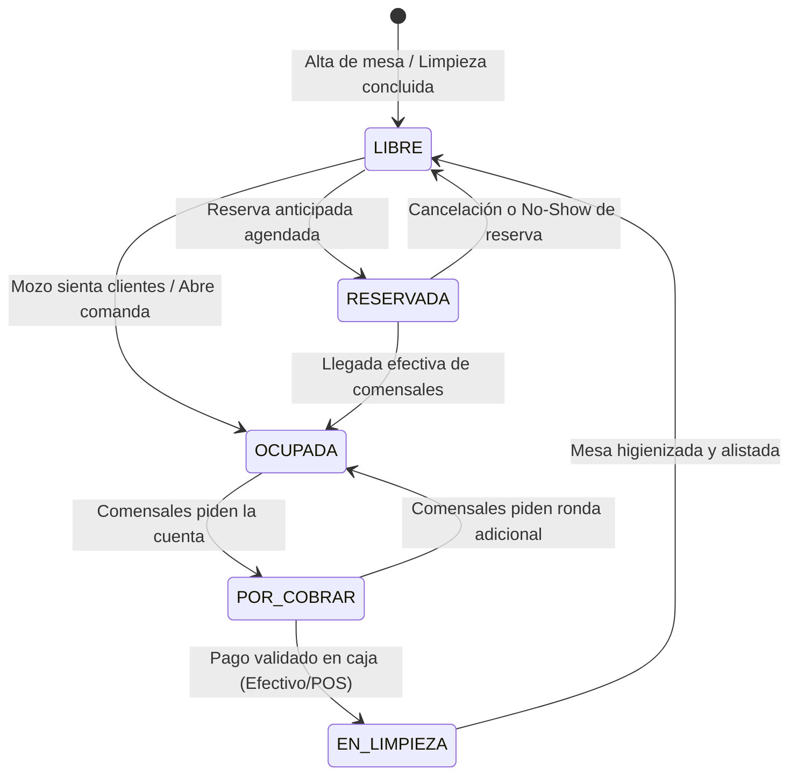
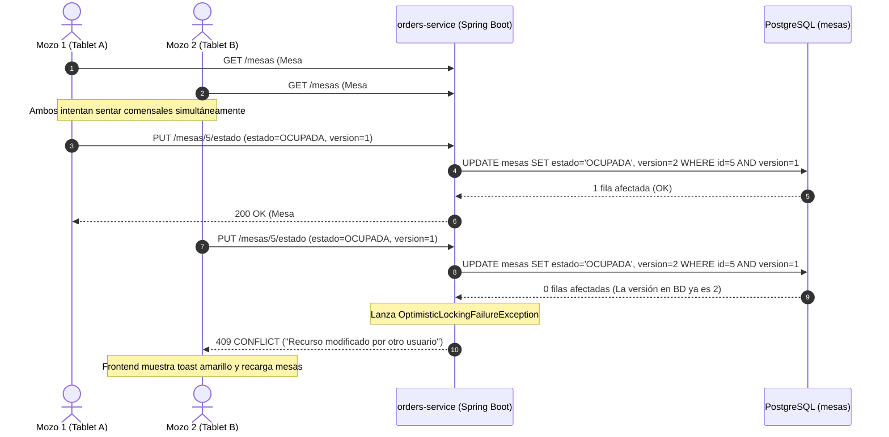

# 📖 Documento Maestro de Estudio: Fase 2 — Operatividad en Salón, Mesas y Tiempo Real

> **Curso:** Desarrollo Web Integrado (Ciclo 7 — UTP)  
> **Proyecto:** Sistema de Gestión y Delivery para Pollería — San Pollo  
> **Nivel Técnico:** Guía de Estudio de Arquitectura, Flujos de Negocio y Sustentación Técnica  
> **Estado:** Implementación Completa y Operativa en Producción Local

---

## Índice General

1. [Problema de Negocio y Objetivos Operativos](#1-problema-de-negocio-y-objetivos-operativos)
2. [Arquitectura de Microservicios y Bounded Context](#2-arquitectura-de-microservicios-y-bounded-context)
3. [Modelo de Persistencia y Base de Datos (PostgreSQL)](#3-modelo-de-persistencia-y-base-de-datos-postgresql)
4. [Teoría y Diseño de la Máquina de Estados](#4-teoría-y-diseño-de-la-máquina-de-estados)
5. [Frontend Reactivo (Angular 19 & Signals)](#5-frontend-reactivo-angular-19--signals)
6. [Ingeniería del Croquis Matricial por Zonas (Slides)](#6-ingeniería-del-croquis-matricial-por-zonas-slides)
7. [Protocolo de Comunicación en Tiempo Real (WebSocket / STOMP)](#7-protocolo-de-comunicación-en-tiempo-real-websocket--stomp)
8. [Estrategia de UX Asíncrona, Resiliencia y Spinners de Carga](#8-estrategia-de-ux-asíncrona-resiliencia-y-spinners-de-carga)
9. [Flujo Operativo End-to-End: Caso de Uso Completo](#9-flujo-operativo-end-to-end-caso-de-uso-completo)
10. [Banco de Preguntas para Sustentación Académica (UTP)](#10-banco-de-preguntas-para-sustentación-académica-utp)

---

## 1. Problema de Negocio y Objetivos Operativos

### 1.1 El Contexto de una Pollería en Horas Pico
En un restaurante de pollería tradicional, los horarios de almuerzo (13:00 a 15:30) y cena (19:30 a 22:30) presentan un volumen crítico de comensales. Los sistemas manuales o POS convencionales sufren tres fallos estructurales:
* **Asignación a ciegas:** Los mozos desconocen visualmente qué mesas están por pagar, cuáles están sucias y cuáles tienen comensales recién sentados sin atender.
* **Desconexión con la cocina:** El mozo debe desplazarse físicamente hasta el pase de cocina para verificar si el pollo a la brasa está servido o esperar que el chef grite la comanda, generando contaminación acústica y enfriamiento del producto.
* **Rigidez espacial:** Cuando se unen mesas para grupos familiares o eventos en terrazas, los sistemas rígidos de números fijos desorientan al personal.

### 1.2 Objetivos de la Fase 2
1. **Digitalizar la topología física:** Representar el establecimiento en un plano gráfico interactivo segmentado por zonas operativas.
2. **Optimizar la rotación de mesas (Table Turnover Rate):** Reducir el tiempo muerto entre la salida de un comensal y la limpieza/ocupación por el siguiente grupo.
3. **Notificaciones Push sin latencia:** Avisar de forma instantánea al mozo en su tablet en el milisegundo exacto en que la cocina marca un plato como `LISTO`.
4. **Delimitar funciones operativas:** Garantizar que el Administrador modele el salón sin estorbar el servicio, y que el Mozo opere comensales sin poder alterar la base estructural de mesas.

---

## 2. Arquitectura de Microservicios y Bounded Context

```
┌────────────────────────────────────────────────────────────────────────────────────────┐
│                              orders-service (:8082)                                    │
│                                                                                        │
│   ┌────────────────────────────────┐         ┌─────────────────────────────────────┐   │
│   │        Subdominio Mesas        │         │         Subdominio Órdenes          │   │
│   │  • MesaController (/mesas)     │◄───────►│  • OrdenController (/ordenes)       │   │
│   │  • MesaService                 │ (Vínculo│  • OrdenService                     │   │
│   │  • MesaRepository              │  Atómico│  • OrdenRepository                  │   │
│   │  • Mesa (Entity + @Version)    │  Mesa-  │  • Orden (Entity)                   │   │
│   │  • MesaEstado (Enum)           │  Comanda│  • OrdenDetalle (Entity)            │   │
│   └───────────────▲────────────────┘    )    └──────────────────┬──────────────────┘   │
│                   │                                             │                      │
│   ┌───────────────▼────────────────┐                            ▼ (Al marcar LISTO)    │
│   │        Subdominio Zonas        │                 ┌─────────────────────┐           │
│   │  • ZonaSalonController (/zonas)│                 │ SalonEventPublisher │           │
│   │  • ZonaSalonService            │                 └──────────┬──────────┘           │
│   │  • ZonaSalonRepository         │                            │                      │
│   │  • ZonaSalon (Entity DDL)      │                            ▼                      │
│   │  • Cuadrículas & Dimensiones   │                 ┌─────────────────────┐           │
│   └────────────────────────────────┘                 │  STOMP WS Broker    │           │
│                                                      │ (/ws-polleria)      │           │
│                                                      └─────────────────────┘           │
└────────────────────────────────────────────────────────────────────────────────────────┘
```

### ¿Por qué un Bounded Context y no un Microservicio `ms-mesas` separado?
Durante el diseño preliminar surgió la propuesta de aislar las mesas en un contenedor independiente. Se descartó por principios de Domain-Driven Design (DDD):
* **Fuerte acoplamiento de ciclo de vida:** Una mesa de restaurante cambia a `OCUPADA` exactamente al abrirse una comanda de salón, y pasa a `POR_COBRAR` cuando dicha comanda solicita pre-cuenta.
* **Evitar transacciones distribuidas (Two-Phase Commit):** Si `ms-mesas` estuviese separado de `orders-service`, ocupar una mesa requeriría coordinar transacciones entre dos bases de datos distintas mediante Sagas o eventos eventuales, abriendo la ventana de inconsistencia (mesa bloqueada sin orden generada o viceversa).
* **Eficiencia de consulta:** Permite calcular en una sola consulta SQL (`JOIN` optimizado o subselect en `orders-service`) qué mesas tienen comanda activa, su total acumulado en soles y el tiempo transcurrido.

---

## 3. Modelo de Persistencia y Base de Datos (PostgreSQL)

### 3.1 Estructura DDL de la Tabla `mesas`
La tabla física reside en la base de datos `polleria_orders`:

```sql
CREATE TABLE IF NOT EXISTS mesas (
    id BIGSERIAL PRIMARY KEY,
    numero INTEGER NOT NULL UNIQUE,          -- Identificador visual de la mesa (Ej: 1, 2, 14)
    capacidad INTEGER NOT NULL DEFAULT 4,     -- Cantidad máxima de comensales (pax >= 1)
    estado VARCHAR(30) NOT NULL DEFAULT 'LIBRE', -- Token de la máquina de estados
    zona VARCHAR(50) NOT NULL DEFAULT 'SALON_PRINCIPAL', -- Slug de la zona física
    posicion_x INTEGER NOT NULL DEFAULT 0,    -- Columna dentro de la cuadrícula matricial (>= 0)
    posicion_y INTEGER NOT NULL DEFAULT 0,    -- Fila dentro de la cuadrícula matricial (>= 0)
    version BIGINT NOT NULL DEFAULT 0,        -- Bloqueo optimista JPA (@Version)
    qr_url VARCHAR(500),                      -- URL directa para escaneo de carta por comensal
    activo BOOLEAN NOT NULL DEFAULT TRUE,     -- Bandera de baja lógica
    created_at TIMESTAMP DEFAULT CURRENT_TIMESTAMP,
    updated_at TIMESTAMP DEFAULT CURRENT_TIMESTAMP
);

CREATE INDEX idx_mesas_zona ON mesas(zona);
CREATE INDEX idx_mesas_estado ON mesas(estado);
CREATE INDEX idx_mesas_activo ON mesas(activo);
```

### 3.2 Estructura DDL de la Tabla `zonas_salon`
Para garantizar consistencia y erradicar la volatilidad de `localStorage`, la infraestructura de cuadrículas se persiste en PostgreSQL:

```sql
CREATE TABLE IF NOT EXISTS zonas_salon (
    id BIGSERIAL PRIMARY KEY,
    slug VARCHAR(50) NOT NULL UNIQUE,             -- SALON_PRINCIPAL, TERRAZA, ZONA_VIP, SEGUNDO_PISO
    nombre VARCHAR(100) NOT NULL,                 -- Nombre amigable para la interfaz
    filas INTEGER NOT NULL DEFAULT 4,             -- Filas de la matriz (mínimo 1)
    columnas INTEGER NOT NULL DEFAULT 5,          -- Columnas de la matriz (mínimo 1)
    color VARCHAR(50) DEFAULT 'border-polleria-gold/40',
    orden INTEGER NOT NULL DEFAULT 1,             -- Orden de visualización en carrusel
    activo BOOLEAN NOT NULL DEFAULT TRUE,         -- Estado habilitado/deshabilitado
    created_at TIMESTAMP DEFAULT CURRENT_TIMESTAMP,
    updated_at TIMESTAMP DEFAULT CURRENT_TIMESTAMP
);

CREATE INDEX idx_zonas_slug ON zonas_salon(slug);
CREATE INDEX idx_zonas_orden ON zonas_salon(orden);
```

### 3.3 Decisiones Críticas en Base de Datos y Persistencia
1. **Control de Concurrencia Optimista (`@Version private Long version`):**  
   Previene colisiones del tipo *Lost Update* cuando dos mozos o un administrador modifican simultáneamente la misma mesa. JPA valida en cada `UPDATE` que la versión coincida (`WHERE id = ? AND version = ?`), incrementando el valor automáticamente. Si la versión difiere, lanza `OptimisticLockingFailureException` y el `GlobalExceptionHandler` traduce el fallo a un código semántico `409 CONFLICT`.
2. **Persistencia Centralizada de Topología (`zonas_salon` vs `localStorage`):**  
   Antes de la auditoría, las dimensiones de la cuadrícula residían en el navegador del cliente (`polleria_zonas_config`). Esto provocaba que si el administrador ajustaba las filas en su laptop, las tablets de los mozos continuaran renderizando dimensiones desfasadas. Centralizarlo en base de datos asegura un *Single Source of Truth* para todo el establecimiento.
3. **Eliminación del constraint heredado `mesas_estado_check`:**  
   En la versión preliminar existía un check restrictivo (`CHECK (estado IN ('LIBRE', 'OCUPADA', 'RESERVADA'))`). Se eliminó para permitir formalmente los estados operativos `POR_COBRAR` y `EN_LIMPIEZA`.
4. **Baja Lógica (`activo = false`):**  
   Si una mesa física se retira por remodelación, el administrador la "da de baja". No se ejecuta un `DELETE FROM mesas WHERE id = X` físico si la mesa tiene órdenes históricas asociadas, preservando la integridad referencial y las auditorías contables del restaurante.
5. **Validación de Integridad en Entidad (`@Min`):**  
   Se añadieron anotaciones Bean Validation `@Min(1)` en capacidad y `@Min(0)` en `posicionX` y `posicionY`, garantizando que valores negativos no corrompan el cálculo de coordenadas matriciales.

---

## 4. Teoría y Diseño de la Máquina de Estados

La gestión de salón modela formalmente una **Máquina de Estados Finita (FSM - Finite State Machine)**:



### Matriz de Transiciones Permitidas

| Estado Origen | Estado Destino | Actor Responsable | Condición o Trigger |
| :--- | :--- | :---: | :--- |
| `LIBRE` | `OCUPADA` | Mozo | Asignación de mesa e ingreso del primer producto. |
| `LIBRE` | `RESERVADA` | Admin / Mozo | Asignación programada con fecha/hora. |
| `RESERVADA` | `OCUPADA` | Mozo | Recepción presencial del cliente reservado. |
| `OCUPADA` | `POR_COBRAR` | Mozo | Solicitud de pre-cuenta para emisión de ticket. |
| `POR_COBRAR` | `OCUPADA` | Mozo | Si el comensal decide pedir postres o bebidas adicionales. |
| `POR_COBRAR` | `EN_LIMPIEZA` | Cajero / Mozo | Pago exitoso de la comanda en caja. |
| `EN_LIMPIEZA` | `LIBRE` | Mozo / Personal | Mesa desinfectada, vajilla retirada y cubiertos colocados. |

---

## 5. Frontend Reactivo (Angular 19 & Signals)

### 5.1 El Rol de `SalonService` como Single Source of Truth
El servicio `SalonService` encapsula el estado reactivo del salón utilizando las primitivas reactivas modernas de Angular 19 (`signal` y `computed`), integrando el ciclo de vida `OnDestroy` para evitar fugas de memoria:

```typescript
// salon.service.ts
@Injectable({ providedIn: 'root' })
export class SalonService implements OnDestroy {
  private http = inject(HttpClient);
  private notify = inject(NotificationService);

  readonly mesas = signal<RestaurantTable[]>([]);
  readonly isLoading = signal<boolean>(false);
  readonly hasError = signal<boolean>(false);
  readonly alertasCocina = signal<AlertaPlatoListoEvento[]>([]);
  readonly zonasSalon = signal<ZonaSalonConfig[]>(DEFAULT_ZONAS_SALON);

  // Signals computados de alto rendimiento
  readonly mesasLibres = computed(() => this.mesas().filter(m => m.estado === 'LIBRE'));
  readonly mesasOcupadas = computed(() => this.mesas().filter(m => m.estado === 'OCUPADA'));
  readonly mesasPorCobrar = computed(() => this.mesas().filter(m => m.estado === 'POR_COBRAR'));
  readonly mesasEnLimpieza = computed(() => this.mesas().filter(m => m.estado === 'LIMPIEZA' || m.estado === 'EN_LIMPIEZA'));

  private pollingInterval: any = null;

  constructor() {
    this.cargarZonas(); // Sincroniza desde GET /zonas en PostgreSQL
    this.cargarMesas();
    this.iniciarSincronizacionEnVivo();
  }

  ngOnDestroy(): void {
    this.detenerSincronizacion(); // Previene memory leaks en SSR y destrucción
  }

  detenerSincronizacion(): void {
    if (this.pollingInterval) {
      clearInterval(this.pollingInterval);
      this.pollingInterval = null;
    }
  }
}
```

### 5.2 Estrategia Híbrida de Sincronización (WebSocket + Polling Fallback)
Para garantizar alta fiabilidad sin depender exclusivamente de una conexión de socket inestable en redes móviles o tablets:
1. **Canal Primario (WebSocket STOMP):** Escucha eventos de broadcast en `/topic/salon/mesas` y `/topic/salon/pedidos-listos`.
2. **Canal de Resiliencia (Polling cada 6s):** `setInterval` reactivo que consulta `GET /mesas` en segundo plano. Si detecta que una orden cambió a `LISTO` y no había sido notificada, dispara el sonido de campana y añade la alerta a la bandeja del mozo.
3. **Detección de Caída de Red:** Si las peticiones periódicas fallan consecutivamente, se activa el signal `hasError.set(true)`, desplegando un banner superior de aviso en la tablet con reintento asistido.

### 5.3 Intercepción de Conflictos de Concurrencia (HTTP 409)
Cuando dos usuarios interactúan simultáneamente sobre la misma mesa (por ejemplo, dos mozos intentando ocupar la mesa #4 al mismo segundo), el backend rechaza la transacción con HTTP `409 CONFLICT`. El servicio maneja reactivamente esta eventualidad:

```typescript
// Intercepción en métodos mutadores de SalonService
catchError((err: HttpErrorResponse) => {
  if (err.status === 409) {
    this.notify.showWarning('⚠️ Conflicto: Otro usuario modificó esta mesa. Actualizando vista...');
    this.cargarMesas(); // Recarga automática del estado más reciente
  }
  return throwError(() => err);
})
```
Este patrón garantiza que la interfaz nunca quede en un estado desfasado (*stale state*) ni sobrescriba silenciosamente el trabajo de otro miembro del personal.

---

## 6. Ingeniería del Croquis Matricial por Zonas (Slides)

### 6.1 Modelo Matemático de Cuadrícula Matricial
En vez de manejar posiciones absolutas en píxeles (`top: 342px, left: 512px`) que se descalabran en pantallas de distinto tamaño, el sistema implementa una **matriz discreta de celdas bidimensionales**:

$$\text{Casilla} = (r, c) \quad \text{donde } 1 \le r \le \text{filas}, \; 1 \le c \le \text{columnas}$$

* **Fila ($r$):** Mapeada a la propiedad `posicionY`.
* **Columna ($c$):** Mapeada a la propiedad `posicionX`.

```
        Columna 1     Columna 2     Columna 3     Columna 4     Columna 5
      ┌─────────────┬─────────────┬─────────────┬─────────────┬─────────────┐
Fila 1│  Mesa #01   │  Mesa #02   │   (Vacía)   │  Mesa #03   │   (Vacía)   │
      ├─────────────┼─────────────┼─────────────┼─────────────┼─────────────┤
Fila 2│   (Vacía)   │  Mesa #04   │  Mesa #05   │   (Vacía)   │  Mesa #06   │
      ├─────────────┼─────────────┼─────────────┼─────────────┼─────────────┤
Fila 3│  Mesa #07   │   (Vacía)   │   (Vacía)   │  Mesa #08   │   (Vacía)   │
      ├─────────────┼─────────────┼─────────────┼─────────────┼─────────────┤
Fila 4│   (Vacía)   │  Mesa #09   │  Mesa #10   │   (Vacía)   │  Mesa #11   │
      └─────────────┴─────────────┴─────────────┴─────────────┴─────────────┘
```

### 6.2 Zonas Operativas por Slides
Cada zona representa un área física con características arquitectónicas diferentes, persistidas de manera dinámica en la tabla `zonas_salon` de PostgreSQL:
* **Salón Principal (`SALON_PRINCIPAL`):** 4 Filas × 5 Columnas (20 casillas estándar).
* **Terraza al Aire Libre (`TERRAZA`):** 8 Filas × 9 Columnas (72 casillas para alta capacidad).
* **Zona VIP (`ZONA_VIP`):** 3 Filas × 4 Columnas (12 casillas exclusivas).
* **Segundo Piso (`SEGUNDO_PISO`):** 4 Filas × 6 Columnas (24 casillas).

Cualquier ajuste de dimensiones (filas o columnas) ejecutado por el administrador se persiste en tiempo real mediante `PUT /zonas/{id}/dimensiones`, propagándose a todos los terminales y sesiones del restaurante.

### 6.3 Algoritmo de Auto-Organización en Lote (`forkJoin`) y Rollback Seguro
Cuando el administrador pulsa **"Auto-organizar Zona"**, el sistema ejecuta una reestructuración espacial atómica en el cliente:
1. Filtra las mesas pertenecientes a la zona activa y las ordena por número de mesa.
2. Itera secuencialmente asignando $(r=1, c=1)$, incrementando $c$ hasta agotar las columnas de la zona y saltando a la siguiente fila.
3. Genera un arreglo de Observables HTTP `actualizarPosicionMesa(id, x, y)`.
4. Ejecuta `forkJoin(peticiones)`: espera que **todas** las mesas se persistan en PostgreSQL antes de refrescar el croquis y liberar el spinner.
5. **Mecanismo de Rollback:** Si alguna petición individual falla (por latencia, caída de red o colisión concurrente), el bloque `error` intercepta la anomalía, notifica al administrador mediante toast de error y ejecuta de inmediato `salonService.cargarMesas()`, restaurando las coordenadas originales sin dejar la interfaz en un estado corrupto o inconsistente.

---

## 7. Protocolo de Comunicación en Tiempo Real (WebSocket / STOMP)

### 7.1 Arquitectura del Broker STOMP en Spring Boot
En `orders-service`:
* **Endpoint de Conexión:** `http://localhost:8082/ws-polleria`
* **Transporte:** STOMP sobre SockJS (soporta WebSockets nativos con fallback a XHR streaming).
* **Destino de Notificación:** `/topic/mesas/alertas`

```java
@Configuration
@EnableWebSocketMessageBroker
public class WebSocketConfig implements WebSocketMessageBrokerConfigurer {
    @Override
    public void configureMessageBroker(MessageBrokerRegistry config) {
        config.enableSimpleBroker("/topic", "/queue");
        config.setApplicationDestinationPrefixes("/app");
    }

    @Override
    public void registerStompEndpoints(StompEndpointRegistry registry) {
        registry.addEndpoint("/ws-polleria")
                .setAllowedOriginPatterns("*")
                .withSockJS();
    }
}
```

### 7.2 Emisión y Recepción del Payload
Cuando Cocina marca un plato como preparado:
```json
{
  "tipo": "PEDIDO_LISTO",
  "ordenId": 104,
  "mesaId": 3,
  "mesaNumero": 3,
  "mensaje": "¡Pedido listo para servir en Mesa #3!",
  "timestamp": "21:45"
}
```
En el frontend, la tableta del mozo:
1. Recibe el payload.
2. Inserta la alerta en la cabecera con contador rojo pulsante.
3. Emite un toast con feedback visual y sonido de alerta.

---

## 8. Estrategia de UX Asíncrona, Resiliencia y Spinners de Carga

### 8.1 El Problema: "Race Conditions" y Doble Envío
Al operar en una tablet o computadora, un usuario que percibe una demora de 400 ms en guardar una mesa suele hacer clic varias veces consecutivas. En sistemas mal diseñados, esto genera:
* Creación de mesas duplicadas.
* Excepciones de base de datos por colisión de clave única (`duplicate key value violates unique constraint "mesas_numero_key"`).
* Inconsistencias visuales en el croquis.

### 8.2 Solución Implementada: El Patrón "Loading Shield"
Se desarrollaron dos capas complementarias de protección:

```
┌────────────────────────────────────────────────────────────────────────┐
│                        PATRÓN LOADING SHIELD                           │
├───────────────────────────────────┬────────────────────────────────────┤
│     CAPA 1: MODALES DE ACCIÓN     │     CAPA 2: LIENZO DEL CROQUIS     │
├───────────────────────────────────┼────────────────────────────────────┤
│ • Botón Submit cambia texto a     │ • Overlay absoluto                 │
│   "Guardando..." o "Creando...".  │   (bg-slate-950/85 backdrop-blur). │
│ • Inserción de SVG animate-spin   │ • Círculo giratorio dorado con     │
│   circular dentro del botón.      │   onda exterior pulsante (ping).   │
│ • Bloqueo total de inputs:        │ • Absorbe todos los eventos de     │
│   [disabled]="isProcesandoMesa()" │   clic o arrastre del mouse.       │
│ • Botón cancelar deshabilitado.   │ • Se oculta solo tras finalizar.   │
└───────────────────────────────────┴────────────────────────────────────┘
```

### 8.3 Control de Concurrencia Optimista (`@Version`) y Resolución de Conflictos (HTTP 409)

En un restaurante en horas de máxima afluencia, los mozos operan terminales independientes de forma concurrente. Esto genera un riesgo crítico de **Lost Updates (Sobreescrituras Perdidas)**:



#### ¿Por qué Bloqueo Optimista y no Pesimista (`SELECT ... FOR UPDATE`)?
* **Bloqueo Pesimista (Pessimistic Locking):** Bloquea las filas en la base de datos hasta que el mozo complete la transacción. En un entorno web/móvil, si un mozo deja un modal abierto o pierde conexión temporalmente, las filas quedarían bloqueadas, agotando el pool de conexiones (HikariCP) y provocando cuellos de botella masivos o deadlocks.
* **Bloqueo Optimista (Optimistic Locking):** No retiene ningún lock en la base de datos durante el tiempo de pensamiento del usuario. Asume que la colisión es infrecuente; cuando ocurre, la detecta limpiamente en el `UPDATE` mediante la columna `version`, cancela la mutación conflictiva y delega la resolución al cliente.

---

## 9. Flujo Operativo End-to-End: Caso de Uso Completo

A continuación se detalla el ciclo de vida de atención presencial en una jornada típica:

```
PASO 1: CONFIGURACIÓN INICIAL (ADMIN)
El Administrador ingresa a /admin ➔ Pestaña "Salón y Mesas".
Observa el croquis de la "Terraza al Aire Libre".
Hace clic en la casilla vacía F2:C3 ➔ Se abre modal con coordenadas (X=3, Y=2).
Ingresa capacidad 6 personas ➔ Pulsa "Registrar Mesa".
Aparece el spinner de carga ➔ El backend responde 201 Created ➔ Aparece Mesa #12 (Verde: LIBRE).

PASO 2: LLEGADA DE COMENSALES (MOZO)
Llega una familia de 5 personas.
El Mozo abre su tablet en /mozo ➔ Selecciona slide "Terraza".
Toca la Mesa #12 ➔ Toca "Asignar Comensales" ➔ Estado cambia a OCUPADA (Rojo).

PASO 3: TOMA DE COMANDA RÁPIDA (MOZO)
En la tablet, pulsa "+ Tomar Comanda" vinculada a Mesa #12.
Selecciona: 1x Pollo Entero con Papas, 1x Porción Tequeños, 1x Chicha Morada 1L.
Añade nota: "Papas bien doradas".
Pulsa "Enviar a Cocina" ➔ Se genera la Orden #POL-504 en PostgreSQL.

PASO 4: PREPARACIÓN Y DESPACHO EN COCINA
El Chef en su pantalla KDS (/cocina) visualiza la orden entrante con timer.
Inicia cocción (PREPARANDO) ➔ Al servir la bandeja en el pase, pulsa "LISTO".
Backend ejecuta salonEventPublisher.publicarAlertaPlatoListo(...) vía WebSocket.

PASO 5: NOTIFICACIÓN Y SERVICIO (MOZO)
La tablet del Mozo vibra y suena la campana: "¡Pedido listo para servir en Mesa #12!".
El mozo recoge la bandeja del pase y la sirve a los clientes.

PASO 6: SOLICITUD DE CUENTA Y COBRO (MOZO Y CAJA)
Los comensales piden la cuenta.
El Mozo en su croquis toca la Mesa #12 y selecciona "Pedir Cuenta".
El estado cambia a POR_COBRAR (Ámbar Pulsante).
Caja emite el comprobante y cobra en efectivo.

PASO 7: HIGIENIZACIÓN Y LIBERACIÓN
Al retirarse la familia, la mesa pasa a EN_LIMPIEZA (Celeste).
El mozo limpia la superficie, desinfecta y alista nuevos cubiertos.
Toca "Marcar como Libre" ➔ Mesa #12 regresa a LIBRE (Verde), lista para el siguiente ciclo.
```

---

## 10. Banco de Preguntas para Sustentación Académica (UTP)

### P1: ¿Por qué decidieron mantener el módulo de mesas en `orders-service` y no en un microservicio autónomo?
> **Respuesta:**  
> "Por diseño guiado por el dominio (DDD). Una mesa y su orden de salón tienen un ciclo de vida atómico y transaccionalmente acoplado. Separar mesas en un servicio físico independiente obligaría a implementar un patrón de transacciones distribuidas (Saga o Two-Phase Commit) para coordinar la simple apertura de una mesa con su comanda, aumentando la latencia de red y el riesgo de inconsistencias. Mantenerlo como un Bounded Context desacoplado dentro de `orders-service` garantiza transaccionalidad ACID en PostgreSQL sin sacrificar la modularidad del código."

### P2: ¿Cómo garantizan que la posición de una mesa no se solape con otra en el croquis?
> **Respuesta:**  
> "Mediante un modelo de cuadrícula matricial discreta. A nivel de frontend, la función `getMesaEnCasilla(row, col)` valida en tiempo real si una casilla ya posee una entidad asignada antes de permitir cualquier operación de arrastre o clic. Si la casilla está ocupada, la acción se bloquea preventivamente notificando al usuario. Además, en el backend cada mesa registra sus enteros `posicionX` y `posicionY` vinculados a una `zona` específica."

### P3: ¿Qué ocurre si la conexión WebSocket se cae mientras el mozo está en una zona con baja señal WiFi?
> **Respuesta:**  
> "El sistema implementa una arquitectura de resiliencia con doble canal. Si el canal WebSocket STOMP pierde conectividad, entra en juego el fallback de polling reactivo de alta frecuencia configurado en `SalonService` (cada 6 segundos). Este mecanismo consulta `GET /mesas` en segundo plano y detecta si alguna mesa pasó a tener su orden en estado `LISTO`, disparando la notificación visual y auditiva sin que el mozo pierda la alerta."

### P4: ¿Por qué implementaron estados de carga y overlays durante la gestión de mesas?
> **Respuesta:**  
> "Para neutralizar race conditions y envíos duplicados por dobles clics. Al interactuar con el croquis o los modales, la interfaz despliega un overlay de bloqueo con spinner SVG giratorio (`animate-spin`) y deshabilita los botones de envío (`[disabled]="isProcesandoMesa()"`). Esto congela el lienzo hasta recibir la respuesta 200 OK del servidor, ofreciendo una experiencia asíncrona robusta y profesional."

### P5: ¿Cómo resolvieron la persistencia de las dimensiones de las cuadrículas si múltiples terminales operan el salón?
> **Respuesta:**  
> "Inicialmente se evaluó almacenar las cuadrículas en `localStorage`, pero una auditoría de consistencia demostró que causaba desincronización entre terminales. Se refactorizó la arquitectura creando la entidad relacional `ZonaSalon` en PostgreSQL, expuesta mediante la API REST (`GET /zonas` y `PUT /zonas/{id}/dimensiones`). De esta forma, cuando el administrador redimensiona una zona en su panel, los cambios se persisten en base de datos y se propagan de inmediato a las tablets de los mozos, manteniendo un Single Source of Truth estricto."

### P6: ¿Cómo previene el sistema que dos mozos modifiquen la misma mesa al mismo tiempo (Race Conditions / Lost Updates)?
> **Respuesta:**  
> "Implementamos **Control de Concurrencia Optimista** mediante JPA `@Version` en la entidad `Mesa`. Cada vez que se consulta una mesa, se entrega su número de versión actual. Al enviar un `PUT`, el backend ejecuta `UPDATE mesas SET ..., version = version + 1 WHERE id = ? AND version = ?`. Si otro mozo ya modificó la mesa una fracción de segundo antes, la condición de versión falla y Spring Boot lanza `OptimisticLockingFailureException`. El `GlobalExceptionHandler` captura este fallo y responde con HTTP `409 CONFLICT`. En el frontend, `SalonService` intercepta el 409, muestra una notificación toast de advertencia al mozo (*'⚠️ Conflicto: Otro usuario modificó esta mesa'*) y re-ejecuta automáticamente `cargarMesas()` para actualizar la pantalla sin destruir el flujo."

### P7: ¿Qué estrategia de resiliencia adoptaron ante caídas o indisponibilidad de la pasarela de pagos (Mercado Pago)?
> **Respuesta:**  
> "Diseñamos una **Arquitectura de Failover en 3 Tiers**:
> 1. **Tier 1 (Producción/Microservicio):** El frontend intenta crear la preferencia mediante el microservicio backend (`:8083`).
> 2. **Tier 2 (Proxy Directo):** Si el microservicio no responde, se conmuta al proxy directo de Angular hacia la API oficial de Mercado Pago.
> 3. **Tier 3 (Simulador Resiliente / Sandbox):** Si no hay conectividad externa o las credenciales fallan, se activa un fallback transparente que emula la preferencia marcando la transacción con la bandera `isMock: true`.
> Para garantizar total transparencia contable y académica, se implementaron banners visuales ámbar en `/checkout` y en `/seguimiento-pedido?mock=true` que advierten claramente al usuario y al evaluador que el pedido opera en modo demostración/contingencia."

### P8: ¿Cómo garantizan consistencia en la operación de 'Auto-organizar Zona' si una de las peticiones HTTP falla?
> **Respuesta:**  
> "A través de transaccionalidad lógica en el cliente con **Rollback Asíncrono**. Cuando se presiona auto-organizar, el sistema calcula las nuevas coordenadas de todas las mesas y despacha las peticiones concurrentemente usando el operador `forkJoin` de RxJS. Si alguna de las peticiones sufre un error de red o conflicto 409, el bloque `catchError` intercepta el fallo, desactiva el spinner, notifica al administrador mediante toast de error y ejecuta de inmediato `this.salonService.cargarMesas()`. Esto descarta las modificaciones en memoria y restaura las posiciones reales persistidas en PostgreSQL, previniendo estados inconsistentes o mesas superpuestas."

### P9: ¿Cómo previenen fugas de memoria (Memory Leaks) en Angular causadas por el polling periódico y la navegación entre rutas?
> **Respuesta:**  
> "Aplicando estrictamente el ciclo de vida `OnDestroy`. En `SalonService`, el `setInterval` utilizado para la sincronización periódica guarda su referencia interna en `pollingInterval`. La clase implementa `OnDestroy` y define el método `detenerSincronizacion()`, ejecutando `clearInterval(this.pollingInterval)` cuando el servicio o la aplicación se destruyen (crucial durante el SSR de Angular Universal). De igual forma, en `MozoSalonComponent` se implementa `ngOnDestroy()` cancelando todas las suscripciones a RxJS observables y temporizadores locales."
