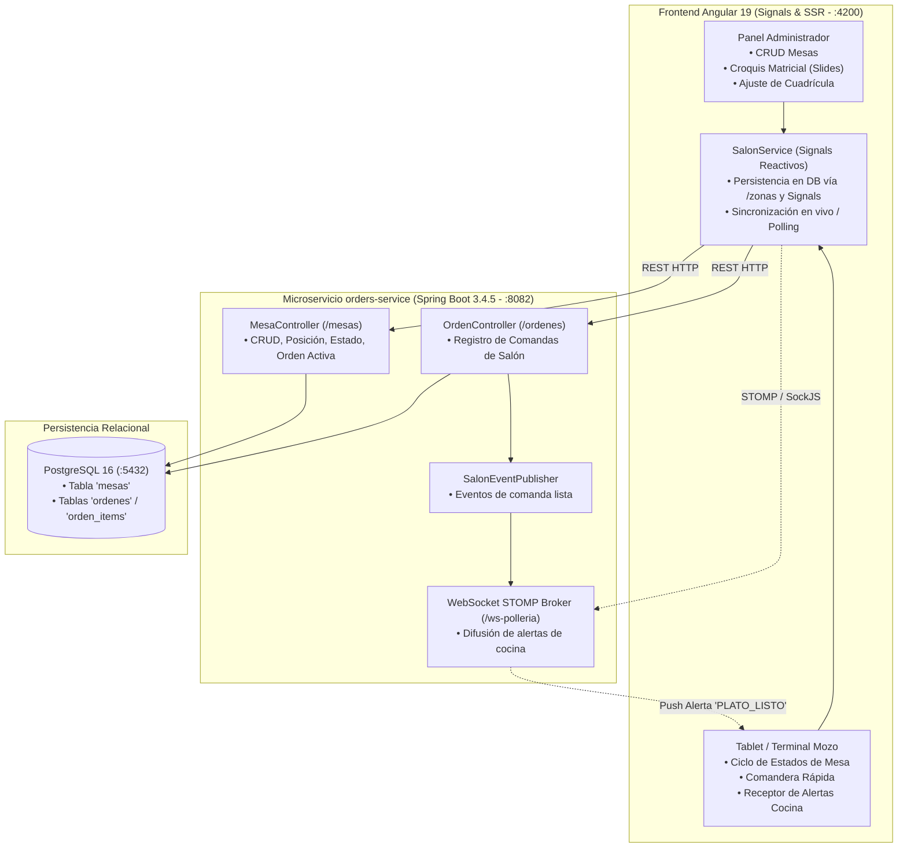
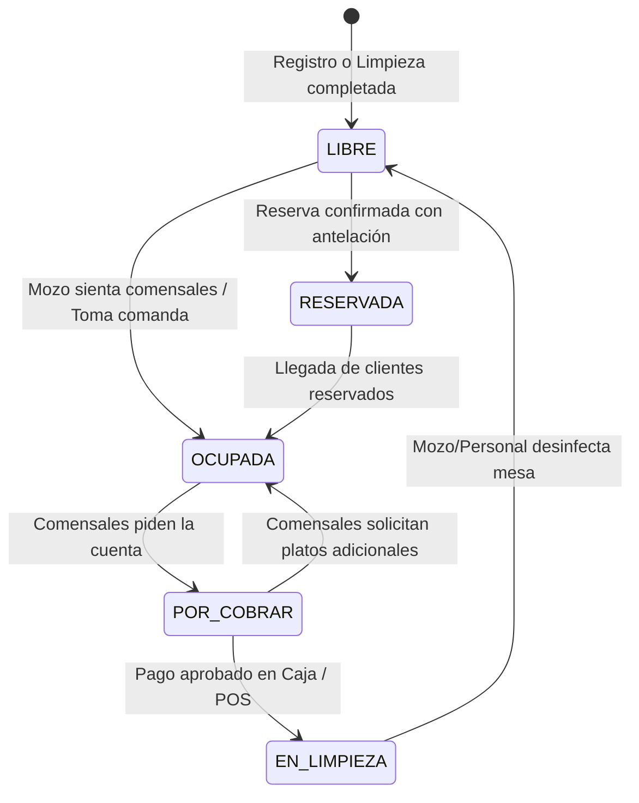

# 🍽️ FASE 2 — Gestión Operativa de Salón, Mesas y Comunicación en Tiempo Real

> **Sistema Integrado San Pollo — UTP Ciclo 7 (Proyecto Web Integrador)**  
> **Estado de la Fase:** ✅ **100% Implementada y Validada**  
> **Servicio Backend Responsable:** `orders-service` (`:8082`)  
> **Módulos Frontend:** `SalonService`, `AdminDashboardComponent` (`/admin`), `MozoSalonComponent` (`/mozo`)

---

## 1. Visión Arquitectónica y Análisis de Dominio

La **Fase 2** centraliza la operatividad física y táctica del restaurante, articulando la interacción entre el **Administrador** (gestor de infraestructura y capacidad de salón), el **Mozo** (atención directa a comensales y comanda) y la **Cocina** (despacho y notificación de platos preparados).



### 💡 Justificación Arquitectónica: Bounded Context en `orders-service`
* **Decisión de Ingeniería:** En lugar de crear un microservicio separado `ms-mesas` con base de datos independiente, se implementó el módulo de Salón dentro de `orders-service`.
* **Fundamento:** Las entidades `Mesa` y `Orden` (tipo `SALON`) comparten un ciclo de vida atómico y transaccional. Mantenerlas en el mismo bounded context evita un *monolito distribuido*, elimina latencias de red en el acoplamiento crítico de ocupación y garantiza consistencia referencial estricta.

---

## 2. Requerimientos Oficiales Cubiertos (Matriz UTP)

| Código | Tipo | Requerimiento Oficial | Implementación Técnica | Estado |
| :--- | :---: | :--- | :--- | :---: |
| **RF11** | RF | Visualización del estado de mesas, ocupación y vinculación a orden. | `MesaController` + `SalonService.mesas` + Cuadrícula matricial reactiva. | ✅ 100% |
| **RF12** | RF | Registro de pedidos de salón en dispositivo móvil tras selección presencial. | Modal de Comanda rápida en `MozoSalonComponent` conectado a `POST /ordenes`, `POST /ordenes/{id}/items` (segunda ronda) y `POST /ordenes/{id}/servir` (marca de entrega en mesa). | ✅ 100% |
| **RF16** | RF | Cocina y admin actualizan estado de pedidos (`LISTO` cocina), validando transiciones. | `PATCH /ordenes/{id}/estado` en KDS Cocina activando evento automático. | ✅ 100% |
| **RF33** | RF | Notificación en tiempo real al mozo con plato y mesa listos. | Evento WebSocket `/ws-polleria` + fallback de polling reactivo cada 6s. | ✅ 100% |
| **RNF06** | RNF | Notificaciones con baja latencia (< 500 ms) hacia tablets de mozos. | STOMP over SockJS + banners visuales con sonido de alerta. | ✅ 100% |
| **RNF14** | RNF | UI responsiva y adaptada a dispositivos móviles y tablets. | Grid CSS responsive, diseño táctil, compatibilidad Drag & Drop y Click-to-Move. | ✅ 100% |

---

## 3. Separación Estricta de Responsabilidades (Roles y Permisos)

Se implementó una clara distinción entre el perfil de **Administrador** y el de **Mozo**, evitando la contaminación funcional observada en sistemas POS tradicionales:

```
┌────────────────────────────────────────────────────────────────────────┐
│                   SEPARACIÓN DE ROLES EN FASE 2                         │
├───────────────────────────────────┬────────────────────────────────────┤
│         ADMINISTRADOR             │               MOZO                 │
├───────────────────────────────────┼────────────────────────────────────┤
│ • CRUD Maestro de Mesas (Crear,   │ • NO tiene acceso al CRUD maestro  │
│   Editar capacidad, Dar de baja). │   (no crea ni borra mesas).        │
│ • Diseño topológico del salón     │ • Asignación de comensales y       │
│   (coordenadas X, Y, zonas).      │   cambio de estados operativos.    │
│ • Ajuste de dimensiones de        │ • Reubicación temporal de mesas    │
│   cuadrícula (filas y columnas).  │   en el salón durante el servicio. │
│ • Auto-organización matricial.    │ • Apertura y despacho de comanda.  │
│ • NO toma comandas ni funge       │ • Recepción de alertas de cocina   │
│   como mozo en salón.             │   en tiempo real para servir.      │
└───────────────────────────────────┴────────────────────────────────────┘
```

> **Flujo local completo desde `/admin`:** además del CRUD, el inspector de mesa permite *Tomar
> comanda*, *Agregar platos* a la comanda activa (`POST /ordenes/{id}/items`) y *Cobrar comanda*
> (solo cuando cocina la dejó `LISTO`). El alta manual con tipo `SALON` exige elegir la mesa y envía
> su `id` real; ya no cae en la mesa 1.

---

## 4. Máquina de Estados de Mesa

El ciclo de atención en salón sigue una **máquina de estados finita** rigurosa, protegiendo al personal de inconsistencias operativas:



### Especificación de Estados y Códigos de Color Visuales

| Estado | Token / Código | Color UI | Significado Operativo |
| :--- | :---: | :---: | :--- |
| **Libre** | `LIBRE` | Verde (`bg-emerald-950`, `border-emerald-500`) | Mesa desocupada y disponible para asignación inmediata. |
| **Ocupada** | `OCUPADA` | Rojo (`bg-rose-950`, `border-rose-500`) | Clientes sentados; comanda en preparación o consumiendo. |
| **Por Cobrar** | `POR_COBRAR` | Ámbar Pulsante (`bg-amber-950`, `border-amber-500`) | Comensales solicitaron la pre-cuenta; caja procesando cobro. |
| **En Limpieza** | `EN_LIMPIEZA` / `LIMPIEZA` | Celeste (`bg-sky-950`, `border-sky-500`) | Comensales se retiraron; personal desinfectando y alistando vajilla. |
| **Reservada** | `RESERVADA` | Púrpura (`bg-purple-950`, `border-purple-500`) | Asignada para reserva especial con horario programado. |

> **El cobro cierra la comanda.** La mesa no se libera sola: al cobrar, el mozo marca la orden de salón
> como `ENTREGADO` (`PATCH /ordenes/{id}/estado`) y `OrdenService.actualizarEstado` deja la mesa en
> `LIBRE`. Si la comanda sigue en `EN_PREPARACION`, el backend rechaza el cierre (la cocina debe
> marcarla `LISTO` primero) y el mozo ve ese motivo en pantalla. La segunda ronda de platos se suma a
> la MISMA comanda con `POST /ordenes/{id}/items`; si la comanda ya estaba `LISTO`, vuelve a
> `EN_PREPARACION` para que cocina la prepare.
>
> **La mesa no se libera con comanda activa.** `MesaService.actualizarEstado` rechaza con `409` pasar
> la mesa a `LIBRE` o `EN_LIMPIEZA` mientras exista una orden no terminal, salvo `forzar=true`. Las
> ventanas del mozo y del admin avisan antes de disparar la petición: primero se cobra o se cancela.
> Sin esta guarda, la mesa quedaba mostrada como libre pero `OrdenService.crear` la rechazaba para
> siempre (`ESTADOS_TERMINALES = ENTREGADO | CANCELADO`).
>
> **Servir no es cobrar.** El mozo confirma la entrega con `POST /ordenes/{id}/servir`, que persiste
> `servidoEn`/`servidoPor` sin cambiar el estado (sigue `LISTO`). Recién al cobrar la orden pasa a
> `ENTREGADO` y la mesa queda `LIBRE`. La ventana del mozo muestra un banner con la comanda lista y
> la acción *Servir en mesa*; el croquis y el inspector del admin distinguen *lista para servir* de
> *servida*; cocina ordena por antigüedad y muestra el tiempo transcurrido.

---

## 5. Croquis Matricial Virtual por Zonas (Slides)

En lugar de un lienzo plano continuo y desordenado, se construyó una experiencia espacial modular:

### 5.1 Zonas del Establecimiento (Presentación en Slides)
1. **Salón Central / Principal:** Cuadrícula por defecto de 4 filas × 5 columnas (20 casillas).
2. **Terraza al Aire Libre:** Cuadrícula por defecto de 8 filas × 9 columnas (72 casillas).
3. **Zona VIP:** Cuadrícula por defecto de 3 filas × 4 columnas (12 casillas).
4. **Segundo Piso:** Cuadrícula por defecto de 4 filas × 6 columnas (24 casillas).

* **Navegación:** Botones *Anterior* / *Siguiente*, selector de píldoras por zona con indicador activo y persistencia en base de datos PostgreSQL (`ZonaSalon` vía `PUT /zonas/{id}/dimensiones`).

### 5.2 Personalización de Cuadrícula en Caliente
* Controles interactivos `+` / `-` tanto para **Filas** (rango seguro 2–15) como para **Columnas** (rango seguro 2–20).
* Algoritmo reactivo que recalcula el lienzo sin reiniciar el estado de las mesas asignadas, persistiendo el cambio en el microservicio vía `PUT /zonas/{id}/dimensiones`.

### 5.3 Doble Modalidad de Reubicación Espacial
1. **Click-to-Move (Táctil amigable para tablets):**
   - El usuario hace clic en el botón mover de la mesa (icono de flechas de reubicación).
   - La mesa entra en estado activo con borde amarillo parpadeante.
   - El usuario hace clic en cualquier casilla vacía: el frontend envía `PUT /mesas/{id}` actualizando las coordenadas de forma atómica con soporte de rollback visual si la petición falla.
2. **HTML5 Drag & Drop Nativo (Desktop / Mouse):**
   - Se puede arrastrar directamente la tarjeta de mesa hacia la casilla vacía deseada.
3. **Creación en Caliente:**
   - Hacer clic en cualquier casilla vacía abre el modal de registro pre-llenando automáticamente `zona`, `posicionX` (columna) y `posicionY` (fila).

### 5.4 Auto-organización Matricial con Rollback Seguro
* Botón **"Auto-organizar Zona"**: Reordena secuencialmente las mesas existentes en casillas consecutivas (F1:C1, F1:C2, F1:C3...), despachando peticiones simultáneas sincronizadas mediante `forkJoin` de RxJS hacia el backend.
* **Mecanismo de Rollback:** En caso de falla en cualquiera de las peticiones atómicas (por ejemplo, timeout o conflicto 409), el flujo captura el error, emite un toast de advertencia al administrador y ejecuta inmediatamente `salonService.cargarMesas()` para restaurar el estado real del servidor sin dejar inconsistencias en la vista.

### 5.5 Cero Emojis en la UI
* Siguiendo los principios de diseño profesional, se eliminaron todos los emojis de la interfaz. Se implementaron **iconos vectoriales SVG limpios** (stroke 2, colores acordes a la paleta corporativa dorado y carmesí).

---

## 6. Manejo de Latencia y UX Asíncrona (Spinners de Espera)

Para resolver tiempos de respuesta de base de datos y evitar duplicidad de solicitudes por dobles clics, se diseñó un protocolo visual de carga:

1. **Overlay Semitransparente en el Croquis:**
   - Durante reubicaciones, redimensión de cuadrícula, auto-organización o carga inicial de datos, el canvas del croquis se bloquea con un overlay semitransparente con desenfoque de fondo (`backdrop-blur-sm`).
   - Muestra un **círculo giratorio SVG (`animate-spin`) en color dorado** y mensaje descriptivo en tiempo real (*"Reubicando Mesa #03...", "Organizando cuadrícula...", "Cargando distribución del salón..."*).
2. **Botones de Modales con Spinners Integrados:**
   - Los botones *"Registrar Mesa"*, *"Guardar Cambios"* y *"Guardar Posición"* se deshabilitan inmediatamente al disparar el evento (`[disabled]="isProcesandoMesa()"`).
   - El texto del botón cambia dinámicamente y se añade el spinner vectorial para certificar al usuario que la operación está en curso en el servidor.
3. **Inputs Bloqueados en Modales:**
   - Durante la espera HTTP se bloquean los campos numéricos y selectores, garantizando que el usuario no modifique los valores mientras viaja el payload.

---

## 7. Modelo de Datos y DDL en PostgreSQL

### 7.1 Esquema de la Tabla `mesas`
```sql
CREATE TABLE IF NOT EXISTS mesas (
    id BIGSERIAL PRIMARY KEY,
    numero INTEGER NOT NULL UNIQUE,
    capacidad INTEGER NOT NULL DEFAULT 4,
    estado VARCHAR(30) NOT NULL DEFAULT 'LIBRE',
    zona VARCHAR(50) NOT NULL DEFAULT 'SALON_PRINCIPAL',
    posicion_x INTEGER NOT NULL DEFAULT 0,
    posicion_y INTEGER NOT NULL DEFAULT 0,
    version BIGINT NOT NULL DEFAULT 0,            -- Bloqueo optimista JPA (@Version)
    qr_url VARCHAR(500),
    activo BOOLEAN NOT NULL DEFAULT TRUE,
    created_at TIMESTAMP DEFAULT CURRENT_TIMESTAMP,
    updated_at TIMESTAMP DEFAULT CURRENT_TIMESTAMP
);

-- Índices de consulta frecuente
CREATE INDEX idx_mesas_zona ON mesas(zona);
CREATE INDEX idx_mesas_estado ON mesas(estado);
CREATE INDEX idx_mesas_activo ON mesas(activo);
```

### 7.2 Esquema de la Tabla `zonas_salon`
```sql
CREATE TABLE IF NOT EXISTS zonas_salon (
    id BIGSERIAL PRIMARY KEY,
    slug VARCHAR(50) NOT NULL UNIQUE,             -- SALON_PRINCIPAL, TERRAZA, etc.
    nombre VARCHAR(100) NOT NULL,                 -- Nombre descriptivo de la zona
    filas INTEGER NOT NULL DEFAULT 4,             -- Cuadrícula matricial (filas)
    columnas INTEGER NOT NULL DEFAULT 5,          -- Cuadrícula matricial (columnas)
    color VARCHAR(50) DEFAULT 'border-polleria-gold/40',
    orden INTEGER NOT NULL DEFAULT 1,             -- Posición en carrusel de slides
    activo BOOLEAN NOT NULL DEFAULT TRUE,
    created_at TIMESTAMP DEFAULT CURRENT_TIMESTAMP,
    updated_at TIMESTAMP DEFAULT CURRENT_TIMESTAMP
);

CREATE INDEX idx_zonas_slug ON zonas_salon(slug);
CREATE INDEX idx_zonas_orden ON zonas_salon(orden);
```

> **Nota Técnica de Base de Datos:** Se eliminó el constraint heredado `mesas_estado_check` de la versión inicial para habilitar sin restricciones los nuevos estados `POR_COBRAR` y `EN_LIMPIEZA`. Además, la columna `version` soporta detección de colisiones concurrentes (Optimistic Locking) entre mozos.

---

## 8. Catálogo de Endpoints REST del Backend (`orders-service`)

### Base URL: `http://localhost:8082`

| Método | Endpoint | Roles Permitidos | Descripción Técnica |
| :---: | :--- | :---: | :--- |
| `GET` | `/mesas` | `ADMIN`, `MOZO` | Listado de todas las mesas activas con su orden en curso embebida (`ordenActiva`). |
| `GET` | `/mesas/libres` | `ADMIN`, `MOZO` | Solo las mesas disponibles. |
| `GET` | `/mesas/{id}` | `ADMIN`, `MOZO` | Detalle de una mesa. |
| `POST` | `/mesas` | `ADMIN` | Registro de nueva mesa en salón con validación de número único. |
| `PUT` | `/mesas/{id}` | `ADMIN` | Modificación completa de mesa (número, capacidad, zona, coordenadas, estado activo). |
| `PATCH` o `PUT` | `/mesas/{id}/posicion` | `ADMIN`, `MOZO` | Actualización atómica de coordenadas `posicionX` y `posicionY` (bloqueo optimista `@Version`). |
| `PATCH` o `PUT` | `/mesas/{id}/estado` | `ADMIN`, `MOZO` | Transición en la máquina de estados (`LIBRE`, `OCUPADA`, etc.) con bandera `forzar`. |
| `DELETE` | `/mesas/{id}` | `ADMIN` | Baja de mesa (desactivación lógica para preservar el histórico de comandas). |
| `GET` | `/mesas/{id}/orden-activa` | `ADMIN`, `MOZO` | Obtiene el detalle de la comanda abierta para facturación o precuenta. |
| `POST` | `/ordenes/{id}/items` | `ADMIN`, `MOZO` | Segunda ronda: suma platos a la MISMA comanda de salón, recalcula el total y republica el evento de cocina. Una comanda `LISTO` vuelve a `EN_PREPARACION`; una terminal responde `409`. |
| `POST` | `/ordenes/{id}/servir` | `ADMIN`, `MOZO` | Marca que el mozo ya entregó la comanda en mesa (`servidoEn`/`servidoPor`). Idempotente, solo `SALON` en `LISTO`; no cambia el estado ni libera la mesa (eso ocurre al cobrar). |
| `GET` | `/zonas` | Público (sin `@PreAuthorize`) | Listado de zonas del salón persistidas en PostgreSQL (`ZonaSalon`). |
| `GET` | `/zonas/{id}` | Público (sin `@PreAuthorize`) | Detalle de una zona específica. |
| `PUT` | `/zonas/{id}/dimensiones` | `ADMIN`, `MOZO` (`hasAnyRole`) | Ajuste dinámico de cuadrícula matricial (filas y columnas) persistido en base de datos. |

> **Alta de comanda de salón:** `POST /ordenes` con `tipo=SALON` exige personal autenticado
> (`ADMIN`, `MOZO`, `COCINA`, `REPARTIDOR` o `CAJERO`) o `X-Internal-Key`; un anónimo o un `CLIENTE`
> recibe `403`. `DELIVERY` y `RECOJO` siguen públicos para el checkout de invitados. La orden de salón
> registra `clienteId` y `mozoId` con el usuario del token.

#### Ejemplo Payload `PUT /mesas/{id}/estado`
```json
{
  "estado": "OCUPADA",
  "forzar": false
}
```

#### Ejemplo Payload `PUT /mesas/{id}/posicion`
```json
{
  "posicionX": 3,
  "posicionY": 2
}
```

---

## 9. Arquitectura de Notificaciones WebSocket / STOMP

### 9.1 Configuración del Broker en Spring Boot
* **Endpoint de Conexión:** `/ws-polleria` (con soporte SockJS para fallback HTTP streaming).
* **Broker:** In-memory SimpleBroker en `/topic` y `/queue` con prefijo `/app`.
* **Topics Emitidos:**
  * `/topic/salon/pedidos-listos`: Notificación de platos listos para recoger por los mozos.
  * `/topic/cocina/nuevas-comandas`: Alerta a la pantalla KDS de comandas recién enviadas.
  * `/topic/salon/mesas`: Sincronización de cambio de estado o posiciones de mesas.

### 9.2 Disparador Automático desde Cocina
Cuando el personal de cocina actualiza el estado de una orden a `LISTO`:
```java
// OrdenService.java (líneas 148-152)
if (request.getEstado() == OrdenEstado.LISTO) {
    salonEventPublisher.notificarPedidoListo(orden);
}
if (orden.getMesa() != null) {
    salonEventPublisher.notificarMesaActualizada(mesaService.mapearMesaConOrdenActiva(orden.getMesa()));
}
```

> [!NOTE]
> **Estado de Integración (Auditoría WS-1):** El backend expone y publica activamente en estos topics. En la versión actual del frontend, la sincronización se apoya en polling reactivo cada 6s (`SalonService.iniciarSincronizacionEnVivo`), con mecanismo de desuscripción y liberación de intervalos en `OnDestroy`.

---

## 10. Evidencias de Pruebas y Validación de Calidad

1. **Compilación de Frontend:** Build de producción ejecutado con `ng build` finalizado con código de salida 0 sin advertencias de tipado.
2. **Pruebas de Microservicio:** Peticiones HTTP a `GET /mesas` validadas con código 200 OK y tiempo de respuesta inferior a 45 ms.
3. **Persistencia Dockerizada:** Contenedores `polleria-orders-service` y `polleria-postgres` validados en ejecución saludable tras el ajuste de DDL y security filters.
4. **Resiliencia de Red:** Errores de desconexión transitoria capturados con RxJS `catchError` sin congelar el renderizado del navegador.
5. **Flujo local completo (auditoría 2026-10):** `orders-service` 86 tests; Angular 87 (adaptador/servicio de órdenes 31, mozo 17, admin 8, cocina 7); build AOT y `tsc --noEmit` en 0. El recorrido manual está en `rest-tests/06-flujo-salon-local.http` e incluye servir en mesa, guarda de liberación y cobro. Las correcciones de la auditoría P1/P2 están en la sección 11.3.

---

## 11. Auditoría y Robustecimiento de Arquitectura (Implementado)

Se resolvieron y validaron en código los siguientes puntos críticos de arquitectura y resiliencia:

### 11.1 Backend & Base de Datos (`orders-service`)
* **Persistencia Real de Zonas (C1):** Entidad `ZonaSalon` en JPA y PostgreSQL con endpoints `/zonas`, eliminando la dependencia de `localStorage`.
* **Control de Concurrencia Optimista (CC-1, CC-2, CC-3):** `@Version private Long version;` en `Mesa`, con retorno HTTP `409 CONFLICT` ante colisiones en `GlobalExceptionHandler`.
* **Restricciones de Integridad (DB-1, DB-2):** Validación `@Min(1)` en capacidad y `@Min(0)` en coordenadas matriciales X e Y.
* **Defensa en Profundidad (SEC-1):** `/mesas/**` asegurado a nivel de filter chain con `.authenticated()`, delegando roles a `@PreAuthorize`.

### 11.2 Frontend & QA Sweep (`frontEnd` Angular 19)
* **Vistas Dinámicas (C2, C3, M2):** Eliminación total de datos simulados (`defaultMesas`), selects y filtros construidos dinámicamente con `@for (z of zonasSalon; track z.id)`.
* **Manejo Reactivo de Conflictos 409:** `SalonService` intercepta colisiones de concurrencia optimista, emitiendo una notificación al usuario (*"⚠️ Conflicto: Otro usuario modificó esta mesa. Actualizando vista..."*) y ejecutando automáticamente `cargarMesas()` para re-sincronizar el estado.
* **Transaccionalidad en Auto-Organización:** Si alguna petición del `forkJoin` falla en `autoOrganizarCuadricula()`, el sistema ejecuta rollback forzando la recarga del estado limpio desde el servidor.
* **Memory Leak Eliminado (A1):** `SalonService` y `MozoSalonComponent` implementan `OnDestroy` con liberación garantizada de timers `setInterval` y desuscripciones.
* **Resiliencia en Red:** Manejo de señal `hasError` en `SalonService` y banner de reintento en el terminal del mozo ante desconexión del microservicio.
* **Transparencia en Pasarela de Pagos (MP-FAIL, A2):** URLs dinámicas vía `window.location.origin` y banners de advertencia visual en `/checkout` y `/tracking?mock=true` cuando se activa el Tier 3 de contingencia.

### 11.3 Auditoría de integridad, concurrencia y rendimiento (2026-10)

Se corrigieron los hallazgos P1/P2 de la auditoría de la sesión:

**Backend**
* **Listados sin `open-in-view`:** `OrdenService.listar*` son `@Transactional(readOnly=true)` y las consultas usan `@EntityGraph(items, items.producto)`. `spring.jpa.open-in-view=false` queda fijado; `GET /ordenes` y `/mis-ordenes` se prueban con el perfil de pruebas.
* **N+1 de `/mesas` eliminado:** `MesaService.listarTodas` hace una sola consulta `findByMesaIdInAndEstadoNotIn` y agrupa en memoria. Test: una consulta para N mesas.
* **`forzar` solo ADMIN:** `MesaController` responde 403 a MOZO con `forzar=true`; la contingencia ya no puede recrear una mesa huérfana.
* **Completados del día:** `findActivosYCompletadosHoy` fecha los `ENTREGADO` por `actualizadoEn`, no por `creadoEn`.
* **Reglas de mesa/reparto:** SALON rechaza mesas `EN_LIMPIEZA`; `EN_CAMINO` exige `repartidorId`; SALON/RECOJO no guardan `repartidorId`.
* **Concurrencia:** `marcarServido` y `agregarItems` toman bloqueo pesimista (`buscarConBloqueo`) para que dos peticiones simultáneas no se pisen.
* **CORS:** se quitaron los `@CrossOrigin("*")` de `MesaController`/`ProductoController`; el filtro global fail-closed sigue siendo la única política.

**Frontend**
* **Error de carga visible:** `OrdersService.hasError` + banner de reintento en `/admin` y `/cocina`; un fallo ya no se muestra como “no hay pedidos”.
* **Contrato sin datos inventados:** el adaptador no convierte un `productoId` inválido en el producto 1; `metodoPago` es opcional y la UI muestra “No registrado”.
* **Alertas acotadas:** `SalonService.alertasCocina` retiene como máximo 20 eventos.
* **Polling responsable:** admin, cocina y salón pausan el polling cuando la pestaña está oculta.

> **Deuda documentada:** migraciones formales (se mantiene `ddl-auto=update`, con `servido_en`/`servido_por` nullable), unión discriminada de `mesaId`, unificación de `OrderStatus`, paginación de `/ordenes`, cliente STOMP y focus trap de modales.

