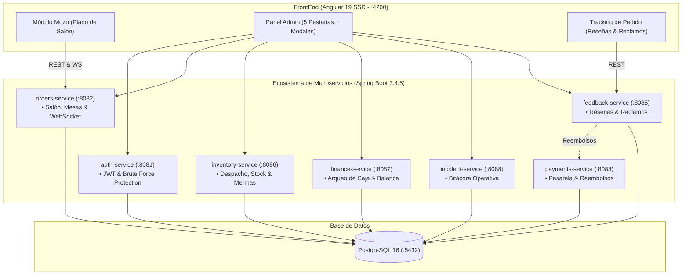

# Guía Técnica de Implementación: Fases 2, 4 y 6 (Sistema Pollería)

Este documento resume la arquitectura, componentes, microservicios y flujos desarrollados y validados durante la sesión de trabajo.

---

## 1. Resumen de Arquitectura del Sistema

---

## 2. Fase 2: Gestión de Salón, Mesas & Comunicación en Tiempo Real

### Backend (`orders-service` :8082)
- **WebSocket Stomp & SockJS:**
  - Endpoint de conexión: `/ws-polleria`
  - Tópico de difusión de alertas de cocina: `/topic/mesas/alertas`
  - Disparador automático: Cuando un pedido de mesa cambia al estado `LISTO` en cocina, `SalonEventPublisher` emite una notificación instantánea al personal de salón.
- **Modelo de Datos y Endpoints REST:**
  - Columnas: `numero`, `capacidad`, `zona`, `posicion_x`, `posicion_y`, `activo` y `estado` (`LIBRE`, `OCUPADA`, `POR_COBRAR`, `EN_LIMPIEZA`, `RESERVADA`).
  - `GET /mesas`: Listado con orden activa embebida y comanda.
  - `POST /mesas`: Alta de mesas con validación de número único.
  - `PUT /mesas/{id}`: Modificación completa (número, capacidad, zona, coordenadas, activo).
  - `PUT /mesas/{id}/posicion`: Posicionamiento Drag & Drop o Click-to-Move.
  - `PUT /mesas/{id}/estado`: Transiciones de la máquina de estados.
  - `DELETE /mesas/{id}`: Baja lógica de mesa conservando histórico contable.
  - `GET /mesas/{id}/orden-activa`: Comanda y consumos en curso.

### Frontend (Angular 19)
- **`SalonService`:**
  - Signals reactivos: `mesas`, `mesasLibres`, `mesasOcupadas`, `mesasPorCobrar`, `mesasEnLimpieza`, `zonasSalon`, `alertasCocina`.
  - Persistencia de dimensiones de zonas en `localStorage` (`polleria_zonas_config`).
  - Sincronización en vivo vía polling reactivo (cada 6s) y receptor WebSocket.
- **Croquis Matricial por Zonas (Slides):**
  - Slides individuales: Salón Central (4×5), Terraza (8×9), Zona VIP (3×4) y Segundo Piso (4×6).
  - Ajuste dinámico de dimensiones (+/- filas y columnas) y auto-organización en lote con `forkJoin`.
  - Doble interacción: Click-to-Move y Drag & Drop nativo HTML5.
  - Creación en caliente haciendo clic en casillas vacías.
  - Reemplazo total de emojis por iconos vectoriales SVG.
- **UX Asíncrona y Spinners de Carga:**
  - Overlay de bloqueo con spinner circular SVG dorado (`animate-spin`) en el lienzo del croquis.
  - Botones con estado de espera (`[disabled]="isProcesandoMesa()"`) en modales de creación y edición.
- **Separación de Roles:**
  - **Admin:** CRUD de infraestructura de mesas, diseño topológico y dimensiones de cuadrícula.
  - **Mozo:** Operación de comensales, comanda rápida de salón y ciclo de estados de mesa.

---

## 3. Fase 4: Feedback, Reseñas y Gestión de Reclamaciones

### Backend (`feedback-service` :8085 + `payments-service` :8083)
- **Reseñas y Métricas de Satisfacción:**
  - `POST /resenias`: Calificación de 1 a 5 estrellas, comentarios y canal de origen (`SALON`, `DELIVERY`, `PICKUP`).
  - `GET /resenias`: Listado consolidado para cálculo de promedios de satisfacción.
- **Libro de Reclamaciones e Incidencias:**
  - `POST /reportes-incidencia`: Registro con orden vinculada, motivo (`PEDIDO_INCOMPLETO`, `DEMORA_EXCESIVA`, `CALIDAD_ALIMENTOS`, etc.), descripción y monto reclamado.
  - `PUT /reportes-incidencia/{id}/resolver`: Resolución administrativa.
- **Integración con Pasarela de Pagos:**
  - `POST /pagos/orden/{ordenId}/reembolso`: Permite reversar pagos parciales o totales cuando se aprueba una reclamación de cliente.

### Frontend (Angular 19)
- **`FeedbackService`:**
  - Signals computados `promedioEstrellas` y `reclamosPendientes`.
  - Métodos `calificarPedido`, `registrarReclamo` y `resolverReclamo`.
- **`order-tracking.component.ts`:**
  - Bloque interactivo de estrellas y modal de libro de reclamaciones directo para el comensal.

---

## 4. Fase 6: Inventario, Finanzas y Seguridad Operativa

### Inventario (`inventory-service` :8086)
- **Despachos a Cocina:** `POST /despachos` descuenta atómicamente el stock de los insumos y asigna responsable y estación de cocina destino.
- **Gestión de Mermas:** `POST /mermas` documenta pérdidas con motivo (`VENCIMIENTO`, `ERROR_COCINA`, `COCCION_EXCESIVA`, etc.) y calcula el impacto financiero.
- **Inteligencia Predictiva:** `GET /inventario/analisis/alertas` proyecta el consumo diario estimado y los días restantes antes de un quiebre de inventario.

### Finanzas y Arqueo de Caja (`finance-service` :8087)
- **Control de Turnos:**
  - `POST /caja/apertura`: Apertura de gaveta con fondo inicial.
  - `POST /caja/movimientos`: Ingresos y egresos de caja chica.
  - `POST /caja/cierre`: Arqueo físico comparando el dinero contado vs el saldo teórico esperado (`montoApertura + ventas - gastos`), detectando sobrantes o faltantes.
- **Balance Diario:** `GET /finanzas/balance-diario` consolida ventas en efectivo de salón, cobros por pasarelas digitales y egresos por reembolsos.

### Seguridad y Auditoría (`auth-service` :8081 + `incident-service` :8088)
- **Protección contra Fuerza Bruta:**
  - `IpBlacklistService`: Bloquea direcciones IP tras 5 intentos fallidos consecutivos de autenticación en una ventana de 15 minutos.
  - `GET /auth/admin/ips-bloqueadas` & `DELETE /auth/admin/ips-bloqueadas/{ip}`: Panel de desbloqueo administrativo.
- **Bitácora de Incidentes:**
  - `POST /incidentes` y `PUT /incidentes/{id}/resolver`: Documentación de contingencias operativas, clasificación por severidad, causa raíz y acciones correctivas aplicadas.

### Panel Administrativo Unificado (`admin-dashboard.component.ts`)
- **Pestaña Mesas:** Plano general, estado y comanda activa por mesa.
- **Pestaña Inventario:** Tabla de insumos con semáforo de criticidad, alertas predictivas, modal de merma y modal de despacho a cocina.
- **Pestaña Finanzas:** Métricas en vivo (caja, pasarelas, balance), flujo de caja menor, modal de apertura y modal de arqueo de cierre.
- **Pestaña Feedback:** Promedio general de satisfacción, listado de reseñas y libro de reclamaciones con resolución compensada.
- **Pestaña Soporte:** Tabla de IPs bloqueadas con botón de desbloqueo manual y formulario de documentación de incidencias.

---

## 5. Auditorías de Calidad Realizadas

1. **Compilación y Pruebas Backend (`mvn test`):**
   - 8 módulos de Spring Boot evaluados sin un solo fallo (100% SUCCESS).
2. **Pruebas de Compilación Frontend (`ng build`):**
   - 0 errores TypeScript (`TS2339`, `TS2353`, `TS2367` todos corregidos).
   - Generación exitosa de bundles de navegador y SSR (`server.mjs`).
3. **Contenedores Docker (`docker compose`):**
   - Creación y verificación de imágenes limpias para los 7 microservicios bajo `docker-compose.local.yml`.
   - Inicialización exitosa de los 9 contenedores en la red `polleria-network`.
